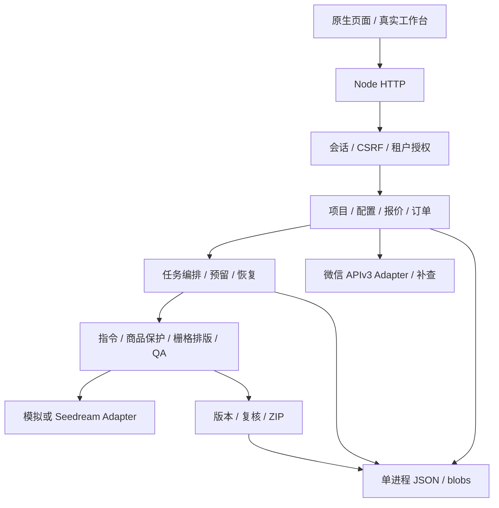

# 千图百炼 · 商品视觉工作台

面向个体商家、个人店主和品牌主理人的商品图工具：上传实拍 → 核对商品事实 → 选择模板与品牌 → 确认报价 → 生成与检查 → 复核 → 下载套图。

**当前是单实例开发与集成验证版本。** 页面、成品额度和微信 Adapter 的内部缺口已修复；真实模型效果、OCR 准确率、商户收款和退款仍需授权外部验收。默认使用模拟图片，默认关闭真实收款。

## 版本与分支

应用版本 `0.23.0`，服务标记 `R12`。新版位于 [feat/commerce-commercialization](https://github.com/CHEN-Cowen/qiantubailian-commerce/tree/feat/commerce-commercialization)。2026-10-27 复核时远端新版为 `29741e7`，默认 `master` 为 `b623b84`；本轮修复为此基准之后的工作区变更，尚不代表远端已经更新。

[原始复核报告](docs/commercialization/复核报告-2026-10-27.md) 保留当时问题与复现证据；[修复与验收记录](docs/commercialization/修复记录-2026-10-27.md) 描述当前状态。

## 当前功能

| 模块 | 功能与边界 |
| --- | --- |
| 账户与工作区 | 邮箱密码、服务端会话、CSRF、租户与角色隔离。邮件验证和找回通道仍需外部邮件服务。 |
| 商品输入 | 项目/SKU、素材上传与替换、来源职责、商品事实版本。创建后自动进入上传。OCR 提供待确认候选，不直接写入已确认事实。 |
| 商品保护 | PNG/JPEG/WebP 解码、自动掩码或手动主体框、掩码预览。本地合成保留原像素；矩形会保留框内背景，边缘、位置和透视需要复核。 |
| 品牌与排版 | 品牌色、字体授权状态、上传的真实 Logo；可调整文字位置、宽度和字号。文字从确认事实编译，合成到最终 PNG/JPEG，并附可编辑 SVG。属于基础排版工具。 |
| 生产与交付 | 冻结配置、报价、任务恢复、有限重试、质检、人工复核、版本与 ZIP 导出。未知检查结果不会自动视为合格。 |
| 套餐与额度 | 展示体验/尝鲜/月包、购买快照和有效期、最早到期优先。真实账户按可交付成品每张 1 点结算，失败释放，待复核保留预留；演示租户保留旧尝试计价。 |
| 微信订单 | 真实 Native 下单、签名与响应验签、通知解密/验签、金额/商户核对、查单、关单、退款与查退款。默认禁用，不能用个人收款码冒充自动到账。 |
| 异常恢复 | 重复通知和退款幂等；退款处理中冻结原订单权益，未知响应保持冻结，成功后回收。每 30 秒补查待支付和处理中退款；异常退款保留冻结并提示商户处理。 |
| 数据与运维 | 首页概览/素材入口使用当前工作区数据；反馈采用率与导出率分开；未核验的货币成本和修订净改善返回空。提供健康探测和租户业务备份。 |

套餐是单次购买，不自动续费。当前配置：体验 3 张/90 天/限一个商品，尝鲜 ¥19/10 张/90 天，日常 ¥69/40 张/30 天，高频 ¥199/150 张/30 天。以 `/api/plans` 实际返回为准，价格仍需结合真实成本验证。

## 本地运行

需要 Node.js `>=22.22.2 <23`。运行依赖为 `sharp`（图片解码与合成）和 `qrcode`（订单二维码）；前端为原生 HTML/CSS/ES Modules，无需打包。

```bash
git clone --branch feat/commerce-commercialization https://github.com/CHEN-Cowen/qiantubailian-commerce.git
cd qiantubailian-commerce
npm ci
npm start
```

访问 `http://127.0.0.1:3000/`。启动脚本读取根目录 `.env`；参考 [.env.example](.env.example)，不提交密钥。服务只监听本机 loopback。

验证真实账户的推荐开发配置：

```dotenv
NODE_ENV=development
HOST=127.0.0.1
PORT=3000
QTB_DEMO_MODE=0
QTB_INITIAL_CREDITS=0
QTB_PAYMENT_PROVIDER=none
QTB_ENABLE_REAL_PAYMENTS=0
QTB_PROVIDER=mock
```

非生产默认可使用演示身份；真实账户注册获得一次 3 张体验额度。默认上架包仅选择 3 张必需交付物，可用体验额度启动。模拟结果可能因尺寸/质量不达标而无法导出，这时不会按成品收费。选择可选交付物会增加报价。

设置 `QTB_DATA_DIR` 可指定持久数据目录，默认是仓库 `runtime`。例如 PowerShell：

```powershell
$env:QTB_DATA_DIR='E:\qtb-data'
$env:PORT='3001'
npm start
```

## 架构



| 路径 | 作用 |
| --- | --- |
| `scripts/start.mjs`、`src/config.mjs` | 环境配置与启动退出 |
| `src/server.mjs`、`src/api.mjs`、`src/auth.mjs` | HTTP、业务路由与授权 |
| `src/domain.mjs`、`src/catalog.mjs`、`src/spec.mjs` | 事实、模板、平台规则和冻结配置 |
| `src/jobs.mjs`、`src/execution.mjs` | 任务调度、执行计划与修订 |
| `src/raster.mjs`、`src/m06.mjs`、`src/ocr.mjs` | 常见图像解码、主体保护、栅格排版和 OCR |
| `src/credits.mjs`、`src/pricing.mjs`、`src/plans.mjs` | 额度批次、成品报价和套餐 |
| `src/providers/` | 图像和微信适配器及环境工厂 |
| `frontend/`、`test/` | 页面、自动回归及本地 HTTP 集成测试 |

## 外部服务与支付

图像默认 `QTB_PROVIDER=mock`。显式选择 `seedream` 必须提供 `PARATERA_API_KEY` 或 `PILOTDECK_SEEDREAM_API_KEY`。当前适配接口没有掩码参数，不接受通过环境变量虚报支持；本地合成需显式开启 `QTB_SEEDREAM_POST_COMPOSITE=1` 并验收实际效果。

OCR 使用 `QTB_OCR_ENDPOINT`、`QTB_OCR_API_KEY`，可选 `QTB_OCR_MODEL` 和超时。未配置就提示不可提取，不返回伪造识别结果。

支付默认 `none`；`mock` 仅供演练。真实支付需显式 `QTB_PAYMENT_PROVIDER=wechat_native`、`QTB_ENABLE_REAL_PAYMENTS=1`，并提供商户号、AppID、APIv3 原始 32 字节密钥、商户私钥、商户证书序列号、平台证书/公钥、平台序列号/公钥 ID、公网 HTTPS 通知地址。配置项见示例文件。不要把个人微信收款码当成商户 API。

当前主体尚无营业执照和商户号，保持真实收款关闭；开通所需外部条件见 [外部依赖清单](docs/commercialization/外部依赖清单.md)。真实 HTTP 实现与模拟契约通过，并不证明真实收款已经验收。

## 验证与部署

```bash
npm test
npm run check
npm run smoke
npm run healthcheck -- http://127.0.0.1:3000
```

自动测试包含登录/隔离、成品额度、退款冻结/重启/跨有效期、通知解密与金额校验，以及签名 HTTP 契约；浏览器人工验收记录见修复文档。测试使用隔离数据和模拟服务，不发生真实扣款。

生产 `NODE_ENV=production` 关闭演示身份、默认启用 Secure Cookie，需同机 HTTPS 反向代理。当前仅支持**单进程、单实例写入一个数据目录**，不能共享目录启动多个实例。数据目录须持久化；业务备份需要授权，会话与账户的整站灾备应另行保护完整数据目录。

`/healthz` 检查进程版本，`/readyz` 检查静态资源；它们不能证明真实模型或收款正常。业务 API 需要登录会话，写请求还需要 CSRF；旧的身份头只适用于开发演示。部署细节见 [部署手册](docs/commercialization/部署手册.md)。
