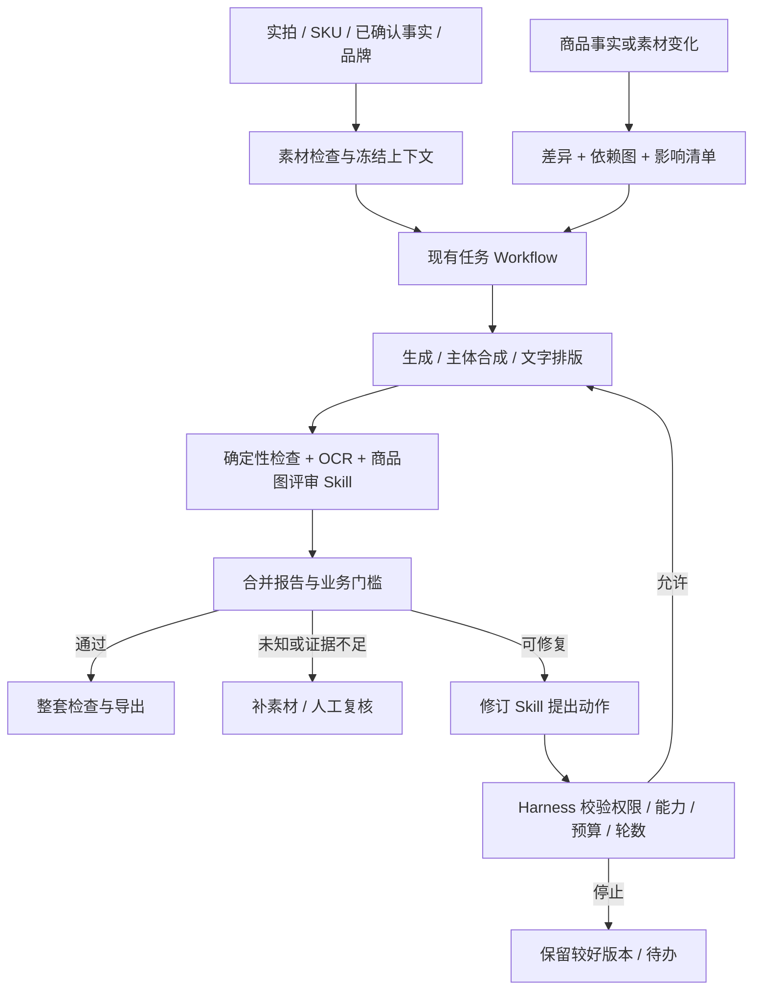

# 千图百炼：商品视觉 AI 工作流升级开发方案

日期：2026-11-05。用途：产品决策、开发交接、验收与面试准备。

## 1. 摘要

将现有商品图生成与更新产品升级为：基于真实商品资料生产图片，由视觉评审发现问题，由受约束的修订规划选择处理方法，由现有任务系统执行、复检、停止和保留版本；商品变化时，只更新受影响内容，最终按整套商品内容验收。

产品目标是提高商品准确性、可交付率和更新效率。不能承诺每张图比所有通用模型更漂亮，也不能把模型自评分上升当作商家效果提升。

本文为开发方案，不表示所列新增能力已经实现。本轮只读核查并编写文档，没有接入真实模型、修改运行逻辑或运行回归测试。

## 2. 负责人及待定事项

| 角色 | 责任 | 当前安排 |
|---|---|---|
| 产品负责人 | 确定首个品类、质量标准、可自动执行范围 | 项目所有者 |
| 开发负责人 | 接入模型、实现策略与状态持久化 | 待安排 |
| 人工验收者 | 标注样本、盲评、裁决争议 | 项目所有者或受邀商家；不能只用模型替代 |

开工前记录首个支持品类、图片用途、真实视觉模型接口、数据发送范围和内部预算。无真实模型时可以完成协议与模拟验证，但不得宣称视觉能力验收完成。

## 3. 现状与差距

以下基于当前工作区代码静态核查，不代表真实外部服务已经验证。

| 领域 | 已有基础 | 本次新增重点 |
|---|---|---|
| 任务执行 | `src/jobs.mjs`：任务、尝试、事件、取消、恢复、预算和修订调度 | 接入视觉报告、受控动作选择、每轮追踪 |
| 生成指令 | `src/execution.mjs`：冻结配置、事实、品牌、文字层与修订指令 | 将经过校验的视觉修复目标编译进请求 |
| 商品保护 | `src/m06.mjs`、`src/raster.mjs`：主体掩码、保护检查、本地合成 | 输入素材质量、保真模式、合成边缘与融合验收 |
| 质量检查 | `src/m07.mjs`、`src/ocr.mjs`：机器检查、OCR、未知与人工复核 | 真实多模态视觉评审及报告映射 |
| 修订版本 | `src/m08.mjs`：有限自动修订、版本、导出门槛 | 视觉动作规划、退步检查、最佳可用版本选择 |
| 商品更新 | `src/change.mjs`、`src/depgraph.mjs`：差异、依赖、影响与动作分类 | 新视觉依赖、更新后复检、套图一致性 |
| SKU 核对 | `src/skucheck.mjs`：归属、结构、视觉候选及导出检查 | 接入带证据的视觉核对，保留未知状态 |
| Skills | `skills/`：小说转提示词、场景评审、修订、整体编排 | 派生商品领域版本，并通过服务端实际执行 |
| 生图工具 | Provider 适配器；另有 Seedream MCP 插件 | 应用侧复用 Provider；MCP 保留给外部 Agent 使用 |

当前自动修订的主要可修复项是文件完整性、格式、尺寸、部分风险画面；不是完整的视觉修订决策。README 标明默认模拟图像、真实模型效果仍待验收。当前 Seedream 适配接口无掩码参数，不能把图生图宣称为严格局部修改。

补充重要业务边界：`change.mjs` 已规定包装关联素材变化需补新实拍；数量或套装文字变化需核对视觉数量。升级不能绕过这些规则。

## 4. 目标与验收指标

首先定义指标和基线，再用实验决定阈值。以下数量与门槛是建议的启动安排，不是已有结果或行业标准。

首轮使用现有商品素材，挑选一个表现稳定的品类；建立约 40–60 个有人工标签的评审案例，覆盖正常图、商品错误、排版问题、素材不足和更新任务。按商品划分开发集和保留验收集，避免同一商品的近似图片泄漏。

| 指标 | 计算与用途 |
|---|---|
| 关键商品错误漏检率 | 人工标注的关键错误中系统未拦截的比例；优先压低 |
| 正常图误拦截率 | 合格图片被判失败的比例；与漏检一起观察 |
| 无法确认率 | 需要补素材或复核的比例；不可通过强制判定降低 |
| 直接采用率 | 人工确认无需额外手改的交付物 / 被评交付物 |
| 修订净改善率 | 原问题改善且未新增关键错误的修订 / 已执行修订 |
| 合格成品成本和耗时 | 包含失败生成、评审、修订与必要复核成本，耗时看中位数与 P95 |
| 更新遗漏率 | 应更新却未进入影响清单的版本 / 人工标注应更新版本 |
| 套图合格率 | 单图和整套检查均通过的套图 / 被评套图 |

发布硬条件：权限、版本绑定、预算、幂等、未知状态和导出门槛必须通过集成验证；验收集中发现的已知关键商品错误不得自动放行。小样本零漏检不代表未来零风险，应报告样本量、错误计数及适用范围。效果门槛在基线后由产品负责人填写，未达到则仅开放建议和人工复核。

## 5. 用户与范围

服务已有实拍素材、需要商品套图并持续维护规格与包装的中小商家。首版以单个稳定品类、固定几类交付物验证，不同时覆盖透明玻璃、镜面金属、复杂珠宝和服饰等全部难题。

首版不训练自有图像模型，不建设通用多 Agent 平台，不自动发布到未接入的电商平台，不将点击率或销量提升当作未经实验的承诺。

## 6. 价值主张

商家只需确认真实商品资料、补充必要素材、处理系统无法判断的事项。系统维护商品与 SKU、品牌和图片版本之间的关系，减少重复描述、错图、无效重生成和更新遗漏。

差异化围绕四项可验证结果：商品正确、修订可控、套图一致、变更后更新准确。Skills、Harness 和 Loop 是实现方式。

## 7. 完整实施方案

### 7.1 总体架构与术语



| 名称 | 在本项目中的具体职责 | 落地证据 |
|---|---|---|
| Skill | 版本化的领域说明、输入输出协议、判定规则与示例 | Skill 文件、加载记录、报告中的版本号 |
| Workflow | 上传、确认、报价、执行、复核、导出的固定业务路径 | 状态机、事件与集成验证 |
| Agent | 在允许范围内根据实际评审选择处理动作的模型决策组件 | 模型动作建议、程序校验、实际工具结果 |
| Agent Loop | 执行、观察、规划、再执行、复检、停止的反馈循环 | 多轮轨迹、停止原因、版本对比 |
| Harness | 向模型提供正确上下文和工具，并管住调用、状态、预算、恢复与验收的运行机制 | 能力清单、策略检查、幂等与恢复验证 |
| Tool / MCP | 实际处理能力和对外接入方式 | 应用 Provider 调用；独立 MCP 工具契约 |

纯规则路由仍属于 Workflow；只有当模型基于观察动态建议动作时，才准确称为受约束的 Agent 决策。Harness 通过扩展现有运行机制实现，无需引入一个同名框架。服务端直接调用 Provider 即可，不必绕行 MCP。

### 7.2 商品保真：靠多层机制共同实现

**A. 建立商品上下文。** 复用商品事实、SKU、素材职责和品牌版本。为每次任务冻结 `project_id / sku_id / truth_version / asset_versions / brand_version / spec_hash`。每张参考图标记主体、包装、背面细节或风格用途；风格图不得充当商品事实来源。

**B. 输入质量检查。** 程序检查解码、像素尺寸、文件重复、主体区域大小；视觉模型补充判断遮挡、反光、关键细节可见性。输出可操作的补拍建议，例如“补一张标签正面近照”，而非笼统提示素材不好。不能从照片推测未经确认的容量或功效。

**C. 确定生成模式。** 默认优先原商品主体与生成背景合成；文字和 Logo 使用真实素材或排版层。允许的主体变换需要记录，不能以任意变形换取视觉效果。需要新视角而现有素材不支持时，提示补拍；首版不承诺任意视角下精确保持商品。

**D. 合成验收。** 同时检查主体保留和融合质量：边缘白边、透明区域、遮挡顺序、接触阴影、光向与透视。原像素保留只能证明局部内容未变，不能证明整体自然。首版可固定机位与版式降低难度。

**E. 最终核对。** 对齐掩码与输出变换后做主体区域比对，结合 OCR、SKU 与真实视觉评审。像素差异和相似度是辅助证据，阈值需按允许变换、压缩和材质校准；不能单凭一个相似度数值宣布商品正确。

接入位置：`m06.mjs / raster.mjs / execution.mjs / m07.mjs / skucheck.mjs`。Skill 主要负责解释视觉问题；事实来源、主体保护和最终发布门槛由程序负责。

### 7.3 商品图评审 Skill

从 `scene-image-critic` 派生 `commerce-image-reviewer`，保留先观察、再对照、后判断及可见证据要求。将小说角色、动作等维度替换为商品身份、包装、颜色、数量、SKU、合成质量、构图、品牌和可读性。

建议新增目录 `skills/commerce-image-reviewer/`，包含 `SKILL.md`、输入输出 Schema 和少量有标注的正反例。这些是待开发交付物，本方案不直接修改现有 Skill。

服务端增加薄调用层：读取受信任的 Skill 正文和版本，组装系统指令、冻结商品上下文、真实参考图片与待评图片，调用多模态模型，解析并校验 JSON。仅在目录里放 Markdown 不构成产品接入；模型不能只收到图片路径字符串。图片必须经服务端鉴权后转成模型支持的实际图像输入。

输入资料与图片内文字均作为待分析数据，不能覆盖系统规则或触发工具调用。模型返回的文件路径、项目 ID 和动作名不能直接执行。

统一报告建议字段：

```json
{
  "schema_version": "commerce-review.1",
  "context_hash": "服务端生成的上下文哈希",
  "artifact_version_id": "待评版本ID",
  "artifact_hash": "待评文件哈希",
  "skill_version": "commerce-image-reviewer.1",
  "checks": [
    {
      "code": "PRODUCT_COLOR",
      "status": "fail",
      "evidence": "参考图瓶盖为白色，待评图瓶盖为黑色",
      "region": [0.3, 0.1, 0.6, 0.4],
      "reference_asset_ids": ["asset_01"],
      "suggested_fix": "恢复原始瓶盖外观"
    }
  ],
  "unknown_reasons": []
}
```

`region` 使用归一化坐标并校验范围；无法可靠定位时允许空值，不应编造。检查项允许 `pass / fail / unknown / not_applicable`。严重程度、硬门槛和最终 decision 由代码根据检查项定义计算，不能让模型降低关键错误的严重程度来放行。

模型、版本、参数、请求 ID、耗时及成本另由服务端写入元数据。模型自述置信度不是经校准的正确概率，不作为自动放行依据。

保留原有确定性检查为独立权威来源，视觉结果不可覆盖文件失败、明确 OCR 冲突或权限问题。缺失关键检查、超时、JSON 不合法均回到未知或待复核。缓存键包含图片与上下文哈希、Skill 和模型版本，资料变化即失效。

### 7.4 商品图修订 Skill 与工具选择

从 `image-quality-refiner` 派生 `commerce-image-refiner`。保留 locked / fix / flexible、每轮优先解决一个重要问题、输出理由的规则，移除小说场景路径与纯文生图清空参考图的默认策略。

输入：有效评审报告、原始参考素材、冻结商品上下文、历史修订、已通过项、程序提供的可用动作和预算摘要。输出动作计划，不直接调用生图、不自行评分、不修改已确认事实。

```json
{
  "schema_version": "commerce-revision.1",
  "based_on_report_id": "report_01",
  "source_version_id": "version_01",
  "action": "recompose_subject",
  "target_check_codes": ["PRODUCT_COLOR"],
  "locked_constraints": ["保留已确认的构图与文案"],
  "parameters": {"subject_asset_id": "asset_01"},
  "reason": "瓶盖颜色被改变，优先复用原始主体"
}
```

以上动作名为建议的新协议，最终以实际实现的工具白名单为准。工具接入顺序：

| 问题 | 动作与实现 | 自动执行边界 |
|---|---|---|
| 格式不匹配 | 本地格式转换 | 原图可正常解码且不损害交付要求 |
| 尺寸问题 | 本地缩放、补画布或重生成 | 不拉伸商品，不把低清放大冒充高细节 |
| 文案、位置、Logo | 现有文字层重合成 | 仅使用已确认事实与授权素材 |
| 主体颜色、包装异常 | 使用原始主体重新合成 | 初期需人工确认效果，不改变实物事实 |
| 背景和光影 | 生成背景后合成 | 当前 Provider 支持且不修改主体 |
| 严格局部编辑 | 掩码编辑工具 | 仅在真实支持、契约与效果验证后启用 |
| 文件损坏 | 获取有效产物或重新生成 | 不能把不可解码文件简单转换为成功 |
| 风险内容 | 分类复核或合规范围内处理 | 不盲目重试供应商拒绝，不绕过安全限制 |
| 未知、缺素材、SKU 归属不明 | 补素材或人工复核 | 不自动猜测 |

第一阶段由规则确定可执行动作；第二阶段才让模型在白名单中选择。程序仍验证动作与问题匹配、素材归属、能力、参数范围、预算和版本。模型选择不存在的能力时拒绝执行，不能静默降级为全图重画。

### 7.5 Harness 和 Agent Loop

复用 `jobs.mjs` 管理业务状态，不再建第二套独立调度器。建议以小模块增加 Skill 调用、动作策略与轮次轨迹，避免继续将所有逻辑写进大任务文件。初始无需向量库、多 Agent 或新工作流框架。

每轮流程：冻结/校验上下文 → 执行选定工具 → 保存新版本 → 独立复检 → 比较通过项与失败项 → 计算是否净改善 → 选下一动作或停止。

保留现有最多三轮修订、连续两轮无改善停止的限制；第一版可将视觉自动修订限制为一轮，验证后再放宽。预算包括评审与规划的真实成本，不只计算生图调用；内部成本与面向用户的成品点数分开记账，沿用当前收费承诺，不能新增隐藏扣点。

必须持久化 `run_id / attempt_id / source_version_id / report_id / plan_id / tool_call_id / idempotency_key / state`。取消后不再安排新动作；迟到响应仅记录；重启恢复先确认在途请求状态，未知不重复扣款或重提交。商品上下文变化时取消旧计划执行资格，重新评审或进入新任务。

版本选择顺序：先满足商品硬门槛，再比较必需问题是否减少，再比较软性质量与成本。存在取舍且无法确定哪个更好时呈现候选供人选择，不以自评分最高或时间最新自动覆盖。未通过版本可留档，但正式导出仍遵循现有门槛。

轨迹记录：问题代码、证据、动作与参数、校验结果、工具结果、前后报告、成本、耗时、停止原因。记录可审计的决策摘要，无需保存或展示模型内部推理。

### 7.6 把商品更新能力做深

继续使用结构化差异和依赖图作为主要方法，LLM 只补充语义提示，不能独自决定是否遗漏某张图。

1. 扩展 `depgraph.mjs`：记录当前图片引用的事实字段、主体素材、SKU、文字层、品牌版本，以及出现在图中的规格与数量表达。区分程序确定、视觉候选、人工关联；视觉未发现不代表依赖不存在。
2. 复用 `diffTruth / computeImpactList / classifyImpact`：生成逐图影响清单。缺依赖或证据冲突的旧图进入复核，不能直接判不受影响。
3. 纯营销文字变化且不影响实物表达时重排文字；实物规格、包装、件数改变时先确认新事实与素材。500ml 改 450ml 不能默认只替换图中文字，包装标签和瓶身也可能变化。
4. 输出逐图动作、原因与报价，确认后由现有任务系统执行。新版本继承可复用版式，不继承失效的事实、主体素材或质检通过结论。
5. 更新后运行单图和套图检查；部分失败独立保留，不把整单显示成已完成。维护旧导出与新版本的替换清单。

验收案例：只改标题不调用生图；换包装必须待补新实拍；套装一件变两件必须复核视觉数量；SKU A 变化不改 SKU B；无依赖旧图转人工；执行中再次改资料使旧计划失效；旧导出可追踪且标记已过期。

只能追踪本产品已知的导出或已接入平台的发布状态，不能声称能发现所有站外图片或已完成远端替换。

### 7.7 从单图扩展到整套质量

先用模板与用户确认生成套图计划，明确主图、卖点图、场景图、规格与包含物说明各自承担的任务。新增 `bundle_manifest`，包含套图 ID、SKU、交付角色、版本 ID、事实/品牌版本、目标渠道和必需信息清单。

第一层为规则检查：交付物齐全、版本有效、尺寸正确、SKU 与事实版本一致、品牌参数一致、必需信息有对应图片、无互相矛盾的结构化文案。

第二层为视觉评审，可在单图评审稳定后增加 `commerce-bundle-reviewer`：比较跨图商品外观、光影风格、文字层级、版式重复与内容覆盖。使用套图缩略总览加逐图细节，禁止仅凭缩略图判断小字正确。

识别近似重复可先使用图像哈希作候选，再结合交付角色和人工判断；同一品牌背景相似不等于内容重复。套图统一不要求所有图片同一构图，应允许主图和说明图承担不同任务。

失败后只对受影响图片安排修订；修订后既检查该图，也重跑相关跨图检查。套图报告不能越过单图硬门槛。交付界面展示单图问题、整套问题、缺失交付物和替换待办。

### 7.8 用户界面与失败处理

用户界面使用“检查商品一致性”“修复背景”“待补标签近照”等具体描述，不要求商家理解 Harness 或 Skill。

增加检查面板、问题定位、修订前后对比、当前采用版本、停止原因与一键切换历史版本。人工确认记录操作者、时间、依据及限定范围；不能通过确认一个未知项消除另一个明确失败。

新增自动修订开关；未授权的高成本重试、需要新素材、无法确认事实、超预算、供应商拒绝都转成明确待办。服务不可用时保留原任务与有效版本，不能展示虚构的视觉评分。

### 7.9 数据、配置与接入点

以现有存储和权限模型扩展，不迁移数据库作为前置条件。建议新增的逻辑对象：`visual_reviews / revision_plans / loop_steps / bundle_manifests / evaluation_runs`；正式命名随实现调整。引用现有图片，不在 JSON 里重复存大体积图像。

所有对象带租户、项目、上下文和版本引用；模型输入仅含当前任务需要的商品信息。密钥留服务端，不进入 Skill、日志和浏览器。由服务端按 ID 获取受权素材，不允许模型提交任意本地路径或 URL 进行读取。

建议配置项涵盖视觉评审启用、模型标识、超时、自动动作白名单、最大修订轮数、单任务内部成本上限。未配置模型时明确不可用。具体接口与模型选择待能力、真实样本效果、成本测试后决定，不预先绑定供应商。

## 8. 分阶段开发、验证与交付

每阶段完成并验收再进入下一阶段，不以文档完成替代运行效果。

| 阶段 | 开发任务 | 必须交付与验收 |
|---|---|---|
| P0：标准与基线 | 首品类、检查表、人工样本、当前系统基线 | 样本清单、标签依据、错误案例、可复跑评测入口 |
| P1：商品上下文与保真 | 素材可用性、事实/素材版本绑定、保真生成与合成检查 | 原主体与输出对比；补拍提示；错误素材/SKU 被拦截 |
| P2：真实评审接入 | 商品评审 Skill、视觉 Adapter、Schema 校验、报告映射与 UI | 图片实际送入模型；超时/无效 JSON 为未知；先仅建议不自动修 |
| P3：修订建议 | 商品修订 Skill、动作白名单、能力检查、报价和对比 | 仅输出并展示可执行计划；人工触发完成工具与复检链路 |
| P4：受控循环 | 自动动作、持久化、预算、停止、退步检测和版本选择 | 恢复/取消/未知/并发验证；自动修订相对 P2 的净收益对照 |
| P5：商品更新深化 | 依赖扩展、影响分类、逐项执行、重新验收与替换待办 | 文字/包装/套装/SKU/历史无依赖/执行中变更等案例 |
| P6：套图验收 | 套图计划、规则检查、视觉联合评审 | 单图合格但整套冲突可被发现；修订仅影响必要图片 |
| P7：效果验证与项目材料 | 公平对照、商家盲评、成本统计、案例复盘 | 数据报告、成功/失败各一条完整演示、能力边界和面试材料 |

P0–P3 可作为首个可展示版本：系统能看图、解释问题、提出具体修复方案；不必等待全自动才能演示。P4 后才主张具备已验证的受控 Agent Loop。每阶段工作量取决于真实接口、样本难度和现有测试情况，不承诺未经估算的日期。

### 8.1 测试与真实效果验证

新增测试集中于高风险契约：报告与版本错配、跨租户素材、模型请求实际包含图片、无效输出与超时、非法动作、预算预留、取消迟到、未知请求恢复、退步与停止、导出失效和更新遗漏。保留现有测试命令，实施时运行相关回归，集成后运行全量验证。

真实图像效果不以模拟测试代替。对照三组：A 通用模型直接生成；B 当前产品流程；C 新评审修订流程。A 与产品使用相同原始商品资料和任务要求，并提供合理的人工提示词，避免故意设置弱基线；B/C 尽量使用同一生图模型隔离工作流贡献。主要比较同预算结果，另行记录等待时间。盲评隐藏来源、随机排序，按商品汇总并记录评审者分歧。开发样例不进入最终保留验收集。

既比较初次生成，也比较“包装或规格改变后的维护任务”；记录人工作业时间。不得用 C 的自评分作为证明 C 获胜的唯一依据。模型/Skill 更新后使用相同保留集回归，并保留失败案例。

### 8.2 风险与降级

| 风险 | 处理 |
|---|---|
| 评审遗漏商品错误 | 人工标注校准、关键项门槛、无法确认转复核 |
| 修订损害已通过项 | 每轮重检通过项、版本保留、不自动采用退步版本 |
| 反复生成使成本上升 | 本地处理优先、有限轮次、预算和无改善停止 |
| 伪局部编辑 | 真实能力注册与效果验证，无掩码支持不宣称精准局部编辑 |
| 更新只改字却与实物冲突 | 实物变化补新素材，数量和规格变化额外核对 |
| 只在固定样例上有效 | 按商品留出验收集，跨新商品复测，明确支持品类 |

## 9. 面试表达与证据准备

### 9.1 叙述顺序

先说商家问题，再说设计取舍，最后说数据。建议围绕“商品保真和持续维护”展开，而不是从框架名称开始。

已完成后可使用的表述模板（必须按实际情况删改，不能提前当作成果）：

> 我把商品图生成与更新做成了可追踪的视觉生产流程。底层保留真实商品素材与确定性排版，上层通过版本化评审 Skill 发现问题，由修订 Skill 在工具白名单内建议动作，再由现有任务系统校验预算、能力与版本，执行有限循环。商品变化时，系统根据字段与素材依赖定位受影响图片，更新后做单图和套图验收。我使用人工标注的保留样本与商家盲评，对比采用率、关键错误、更新遗漏和合格成品成本。

没有数据前不要填写提升比例。仅完成规则调度时称 Workflow；实现并验证模型动作选择后再称受约束的 Agent。不能把仓库中小说场景 Skill 的设计直接说成商品产品已上线能力。

### 9.2 面试应能展示的材料

1. 现状与升级后架构图，说明固定流程、模型决策和执行约束的边界。
2. 一个真实错误案例：参考图、错误输出、评审证据、动作计划、修订前后、成本与停止原因。
3. 一个更新案例：事实变化、受影响清单、为何只改这些图、缺素材时如何停止。
4. 一个失败案例：模型判断不确定或修订变差，系统如何保留版本并交人处理。
5. 评测报告：样本规模、人工标准、对照条件、结果与适用范围。
6. 明确个人负责内容，包括设计、开发、AI 辅助生成与人工验证的具体分工。

## 10. 设计参考

本文使用现有代码确定接入点；架构参考不替代本项目实测。

- [Anthropic：Building effective agents](https://www.anthropic.com/research/building-effective-agents)：区分固定 Workflow 与动态 Agent；评估—优化循环需清晰评价标准和可测收益；保持简单并设置停止条件。本文据此建议复用任务系统，逐步开放模型动作选择。
- [OpenAI：Image generation](https://developers.openai.com/api/docs/guides/image-generation)：图像生成与编辑能力及一致性、精确构图等限制。仅作为能力边界参考，本方案不要求改用该供应商；实际能力以所选 Provider 契约与真实效果验收为准。
