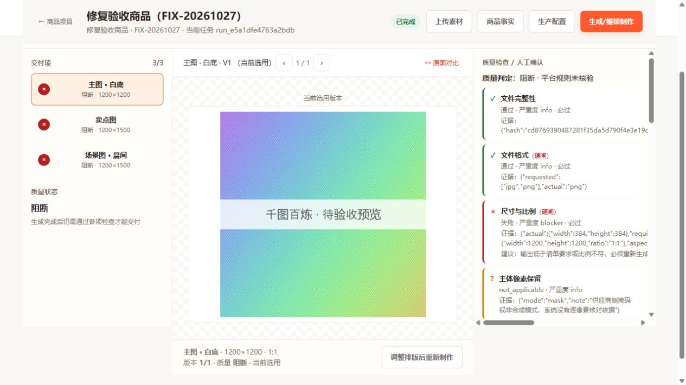
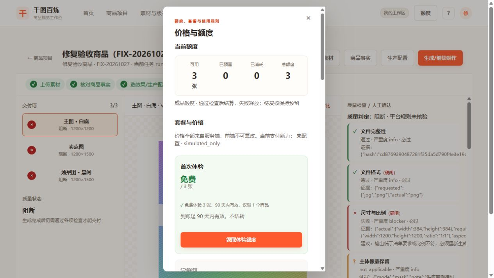

# 千图百炼修复与验收记录

日期：2026-10-27。基准：商业化分支 `29741e7`。本记录描述此后的本地工作区修复；原始报告保留在 [复核报告](复核报告-2026-10-27.md)。

## 修复范围

| 原问题 | 本次处理 |
| --- | --- |
| 工作台打开空白 | 排除隐藏自身的逻辑；真实项目可打开、恢复任务和报告。 |
| 价格入口无响应、字段不匹配 | 初始化价格模块，按套餐真实字段显示价格、规则与免费体验；订单列表、二维码、查单和退款入口已接通。 |
| 微信真实方法未实现、工厂未接线 | 实现 APIv3 Native 下单、查单、关单、退款与查退款；启动接支付工厂。真实收款默认关闭，需显式开启及完整商户配置。 |
| 通知被登录/CSRF 拦截、未核验支付内容 | 通知不依赖用户会话；仍要求验签与解密。核对商户、AppID、订单、金额、币种和交易 ID，重复通知不重复到账。 |
| 微信资源解密协议错误 | 使用原始 32 字节 APIv3 密钥、独立 nonce、AAD、密文末尾认证标签；校验平台序列号和签名时间。 |
| 体验重复发放 | 注册与领取共用唯一发放键；重复创建免费订单不增加额度。 |
| 付费权益无有效期/快照 | 按到账时套餐快照建批次，保存来源订单、有效期与权益；回收时对应原订单批次。 |
| 套餐张数与尝试计价不一致 | 真实账户默认只报价必需图片，每张成品 1 点；3 张体验可启动必需上架包。重试不另扣成品额度，通过检查/复核才结算；失败释放，待复核保持预留。演示租户保留旧测试计价。 |
| 退款处理中误标成功、权益未冻结 | 先持久化退款号与冻结原批次，再请求退款。PROCESSING/网络未知保持冻结，SUCCESS 回收，CLOSED 解除并按有效期处理，ABNORMAL 保持冻结待商户处理。重启与跨有效期可恢复。 |
| 常见实拍/Logo/文字仅接口或占位 | 新增 sharp 解码与栅格合成，支持 JPEG/WebP 输入及主体框预览；候选文字提取接到事实页；品牌使用上传 Logo 原图；基础排版位置/宽度/字号随规格冻结，最终 PNG/JPEG 包含排版，ZIP 附可编辑 SVG。 |
| 假统计与代理指标 | 首页/素材入口显示当前工作区数据；演示块初始隐藏；采用反馈与导出率分开；额度消耗不冒充货币成本，未核验的净改善和货币成本返回空。 |
| 文档与验收不符 | README、环境示例和部署手册已更新，纠正端口、依赖、会话/CSRF 和生产能力说明；补入回归测试与浏览器证据。 |

## 额外发现并修复

- 工作台缺少图片内容接口和原图对比；新增受账户权限保护的版本预览，未通过或未结算时提供缩小、水印预览，避免预览接口绕过交付结算。
- 工作台默认版本未同步质检报告、复核提交格式错误、未通过图片被显示成完整交付。现按真实报告显示，逐项选择可复核检查，提交理由与对照依据，导出入口按检查通过数开放。
- 本地合成证据没有进入质检。现持久化并传递合成结果；PNG 保持逐像素硬检查。JPEG 在压缩前像素一致的前提下，压缩后仍需人工对照确认，不冒充最终像素完全一致。
- 真实 API 请求已签名，微信响应先验签后处理；未知结果不假装成功。后台每 30 秒补查待支付和处理中退款。

## 自动验证

使用 Node.js **22.22.2**，与项目声明一致。

- 全量自动测试：**229 项，228 通过、1 跳过、0 失败**。跳过项为当前系统权限不支持的符号链接场景，不能算已验证。
- 语法检查：**67 个脚本通过**。
- 冒烟：真实启动、HTTP 健康探测与 SIGTERM 退出通过。
- `test/fixes.js` 新增 9 个回归场景：微信标准加密资源、通知/金额/体验/快照、退款冻结和重启、签名 HTTP 请求、3 张体验与失败释放、真实 Logo 像素、跨到期退款、异常退款/关单竞态，以及通过复核后单次扣费与重复导出。预览鉴权、水印和已结算原图也纳入这组测试。

旧测试中“免费体验计真实收入”“未知订单通知直接确认成功”“网络失败即退款失败”等错误预期同步纠正；没有关闭金额核验或放宽硬失败来换取通过。

## 浏览器验收

使用隔离的本地数据、测试账户和仓库自带的样例图片，未调用付费模型或真实收款。

1. 登录后展示工作区真实项目数和 3 张体验余额。
2. 额度入口可打开价格页；未配置商户时购买按钮禁用；重复领取后额度仍为 3。
3. 快捷新建项目后自动打开上传；真实 JPEG 上传成功。
4. 未配置 OCR 时明确提示不可提取；保存主体框后可看到掩码预览。
5. 未满足关键事实时拒绝确认，完成确认后进入生产配置；自定义文字排版可保存为冻结版本。
6. 工作台打开正常；开始前明确报价 3 张、最多消耗 3 张；本地模拟任务产生 3 项结果。
7. 模拟图片实际只有 384px，被尺寸硬检查阻断，不能导出正式包；余额恢复为可用 3、预留 0、消耗 0。
8. 刷新并重开项目可恢复图片预览、真实质检项与阻断状态，避免误显示已通过。

浏览器经过的失败路径与自动测试的成功交付/导出路径共同覆盖内部流程；没有把模拟服务或 HTTP 契约当成真实模型、OCR 或商户交易验收。

## 仍需外部条件

- 当前没有营业执照和微信商户号，真实收款保持关闭。商户入驻、AppID 绑定、公网 HTTPS 通知、证书/公钥配置，以及真实支付和退款验收仍未完成。
- 真实模型生成质量、复杂背景分割、中文 OCR 准确率、平台规则和商用字体需使用授权样本验收。基础主体框会保留框内背景，不等于精细抠图。
- 当前提供基础文字排版与可编辑 SVG，未宣称已经具备完整拖拽画布编辑器。
- 单进程 JSON 存储限制保持不变；不支持多个实例共享目录写入。
- 本次没有合并默认分支、提交或推送远端。当前改动、原始复核文档和验收证据均保留在本地工作区。

完整自动验证输出：[Node 22 验证日志](验收证据/自动验证-Node22.txt)。
