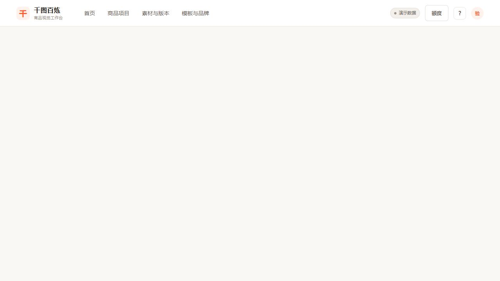

# 千图百炼商业化要求复核

> 本文保留修复前的审计结果；当前修复和验证状态见 [修复记录](修复记录-2026-10-27.md)。

日期：2026-10-27。基准：用户上一轮 R00—R12 完整开发提示词；被检查代码：`29741e7d7756d7cc661a5b239c9d45dcaf8bf118`，应用 `0.23.0`。

## 结论

该仓库实现了面向个体商家与主理人的商品视觉生产框架，并新增身份、任务恢复、套餐和支付接口。按多个独立用户使用、但仍为单实例运行的预期检查，**不能认定全部要求完成，也不能公开收费**：真实工作台和价格入口有实际浏览器故障，成品权益仍沿用旧尝试计价，微信真实调用尚未实现。

R00—R12 都有提交和测试文件，不等于 R00—R12 都满足原验收标准。缺证照/密钥属于外部待办；HTTP 方法未实现、前台未初始化等是可独立开发的内部缺口，应分别记录。

原始复核阶段（修复前）只更新 README、增加本报告和浏览器截图，没有修复业务代码、发起真实支付或调用付费模型，也没有合并分支。

## 远端与分支核对

已成功执行 `git fetch origin`，并用 `git ls-remote --symref origin HEAD` 和指定分支查询核实：

| 远端位置 | 提交 |
| --- | --- |
| 默认 HEAD / master | `b623b84d372dc91cf90ec9605fd9f173cc4642aa` |
| feat/commerce-commercialization | `29741e7d7756d7cc661a5b239c9d45dcaf8bf118` |

本地商业化分支与远端一致。本次检查新版分支，未把默认 master 的旧代码当成新版；用户打开仓库默认页时仍可能看到旧版。GitHub 网页抓取失败，但 Git 远端核对已成功，不存在上次那样的远端版本未确认问题。

## 实际检查结果

| 项目 | 结果与范围 |
| --- | --- |
| `npm test` | 220 项：219 通过、1 跳过、0 失败；本次实际运行，不是引用开发记录 |
| `npm run check` | 65 个 JS 文件语法检查通过 |
| `npm run smoke` | 子进程启动、健康检查和 SIGTERM 收尾通过 |
| 环境 | Windows / Node 24.20.0；仓库声明 Node >=22.22.2 <23，仍需约定版本复验 |
| 浏览器 | 关闭演示身份，实际注册/登录、创建商品、打开额度、打开真实工作台 |
| 权益与支付补充检查 | 使用隔离 createApp 和模拟 Provider；复现重复体验发放、无到期批次、回调认证与金额缺口、退款处理中误标成功及标准密文解密失败 |
| 免费试用链路 | 新账户→上传 900px 合成 PNG→确认事实→冻结配置→报价→启动，因 3 点余额不足 24 点预留而被拒 |
| 真实外部服务 | 未调用真实模型、OCR 或微信收款退款；无真实费用 |

测试数据在仓库外独立 `review-current-runtime` 和本轮独立支付验证目录；未修改原有 runtime。浏览器截图为本轮创建的测试账户，不含密钥/付款信息。

## 逐模块对照

“代码/契约已有”只表示局部可验证，不代表真实外部能力完成。

| 模块 | 复核判断 | 已有证据和剩余范围 |
| --- | --- | --- |
| R00 现状与计划 | 基本具备 | 独立分支和模块提交存在；进度表把外部待验和代码缺口笼统标完成，状态需纠正 |
| R01 身份与权限 | 核心代码/测试已有 | 可信会话、CSRF、注册 owner、集中角色闸口已加入；真实浏览器可登录；邮件恢复未接入 |
| R02 状态/数量/超时 | 核心代码/测试已有 | count 展开、unknown/needs_attention、核对窗口及供应商/租户并发已有；真实供应商故障恢复仍需验证 |
| R03 成品额度 | 未完成 | 批次账本已加，但实际仍按 4/5/6 等旧额度和尝试结算；体验重复领取、订单有效期未接、QA 失败仍扣额度 |
| R04 图像/文字/检查 | 部分完成 | 配置/修订 prompt 编译、OCR Adapter、掩码与 SVG 接口已有；常见实拍的保护链、前台调整、Logo 原图合成与可交付栅格图尚未完整实现 |
| R05 统一工作台 | 未通过 | 新工作台代码、版本/QA/导出接口及恢复逻辑存在；实际打开时自己设为 hidden，页面空白；创建后也没自动进入下一步 |
| R06 页面/配方 | 部分完成 | 首页近期真实项目和配方区已有变化；固定统计、演示素材与演示入口仍在主流程，不能称全真实数据 |
| R07 价格与付费入口 | 未通过 | 套餐目录和价格模块存在；initPricing 未调用，额度按钮无响应；字段契约也与当前后端不一致 |
| R08 微信收款 | 未完成 | 签名/接口/模拟状态测试已有；真实 HTTP 方法未实现、正常启动未接工厂、回调被会话认证拦截、标准解密及金额校验有缺口 |
| R09 退款/追加包 | 未完成 | 有按剩余额度计算退款和重试代码；PROCESSING 被当 success，无最终态/失败解冻完整流程，批次回收/恢复有缺口；不是只缺商户资质 |
| R10 批量/平台输出 | 后端部分完成 | 预算、导出清单/count/dimension/rule_ref 检查已有；前台完整批量入口、逐项重试及真实费用口径仍需补齐；平台规则待核验 |
| R11 指标/部署 | 部分完成 | 有指标、备份检查和部署文档；指标是代理口径，旧命令与身份头说明不准确；迁移和整站灾备/生产验收未完成 |
| R12 整体端到端 | 未通过 | 现有 9 项主要为 HTTP+模拟 Provider；没有替代真实浏览器，且本次实际浏览器和权益检查已经发现阻断 |

## 必须修复：本次确认的问题

### 1. 真实工作台会把自己隐藏（P1，核心流程阻断）

- **位置/作用：** `frontend/workbench.js:180` 的 showWorkbench 负责显示真实商品工作台。
- **问题/证据：** 先设置 panel.hidden=false，随后遍历 `.view[data-view-panel]` 将包括自身在内的所有视图设为 hidden=true；浏览器显示 `{active:true, hidden:true}`，项目标题已正确加载但整页空白。
- **最小修复：** 隐藏其他视图时排除工作台，最后显式设置工作台可见；将“新建→打开真实项目”加入浏览器验收。
- **不修后果：** 用户无法在新工作台继续制作、查看结果或下载，后端通过不能弥补此断点。

复现：真实会话注册→新建商品→首页近期项目“打开工作台”。

### 2. 额度/价格模块从未初始化，且价格字段没有对齐（P1）

- **位置/作用：** `frontend/pricing.js:27` 导出 initPricing；`frontend/index.html` 仅加载脚本，`frontend/app.js` 也没有调用它。
- **问题/证据：** 实际点击“额度”，脚本已加载但 pricing-dialog.open=false，没有错误提示。即使补初始化，前端按 plan.free 判断体验，后端只给 kind/price_cents；订单视图读 total_cents/payment_qr_url，后端给 price_cents/code_url/pay_qr。
- **最小修复：** 正确初始化并使用当前 API 字段，完善二维码、查单、到账、订单列表和回到原任务流程；不能只让弹窗打开就算完成。
- **不修后果：** 用户看不到有效套餐，也无法完成设计中的付费流程。

### 3. 微信真实方法仍为空实现，启动也没接工厂（P1，收费阻断）

- **位置/作用：** `src/providers/wechat.mjs:179` 附近的真实 Provider；`src/providers/payment.mjs` 工厂；`scripts/start.mjs`、`src/server.mjs`、`src/api.mjs` 注入链。
- **问题/证据：** 非零金额 createNativeOrder、queryOrder、closeOrder、refund 均直接 throw“真实 HTTP 调用未实现”。全仓检索确认正常启动没有调用 createPaymentProviderFromEnv，因此环境变量填好也不会构造支付 Provider。
- **最小修复：** 实现可注入 HTTP 的真实 APIv3 Adapter 并接启动校验；先用官方契约/模拟网络验证请求、响应及失败分支，真实交易再等资质和授权。
- **不修后果：** 补营业执照、商户号、密钥后仍然无法收款。这是内部待开发，不应只列为外部待验。

### 4. 微信回调被登录拦截，已进入处理时又缺订单核验（P1）

- **位置/作用：** `src/api.mjs:190` 的 dispatch 在 billing 回调前解析会话并执行 CSRF/权限；`:3647` 才处理通知。
- **问题/证据：** 无站内 Cookie 的微信通知请求返回 401。用已登录测试会话与模拟验签 Provider 发送商户/AppID错误、总金额1分但本地19元的 SUCCESS，接口仍返回200且发10额度；处理函数没有核对这些字段。
- **最小修复：** 将通知放在普通会话前、使用支付验签认证，并校验商户/AppID、订单总额、币种、交易号和状态；验签/持久化失败按微信要求应答并允许重试，不能统一200表示业务失败。
- **不修后果：** 真正的微信无法正常到账；后续仅放开认证也不能保证交易正确。模拟用例带身份头，掩盖了公网回调条件。

### 5. 微信通知解密格式与官方协议不匹配（P1）

- **位置/作用：** `src/providers/wechat.mjs:69` 的 decryptApiV3Resource、verifyNotify 的调用。
- **问题/证据：** 当前从 ciphertext 前12字节取IV，未使用 resource.nonce 和 associated_data；字符串密钥又默认按Base64解码。按官方字段构造 AES-GCM 合法密文，传32字节 Buffer 密钥后仍返回认证失败。
- **最小修复：** 按 APIv3 原始32字节密钥、独立 nonce、associated_data 与密文尾部认证标签解密，结合序列号/公钥配置校验；用官方形状的独立测试向量验证。
- **不修后果：** 即便真实请求和回调路由补完，微信标准通知仍无法解密，mock 直接JSON解析的测试发现不了。

依据：[微信支付官方通知字段与验签说明](https://pay.wechatpay.cn/doc/v3/merchant/4013070368)。

### 6. 首次体验可通过订单反复领取（P1，权益绕过）

- **位置/作用：** `src/api.mjs:3384` 的零金额订单分支绕开 grantExperienceCredits，使用每次新订单号 grant。
- **问题/证据：** 真实注册先得3点；注入无费用支付测试 Provider 后，连续两次购买 plan_first_trial 均返回201，余额3→9。新增批次没有 experience 的单商品约束。
- **最小修复：** 所有体验领取统一走账户/租户唯一的体验发放规则，已领取幂等返回，不能用新订单号绕过；权限和次数规则在后端落实。
- **不修后果：** 接通正式支付 Provider 后可无限领免费额度，绕过一次/一个商品限制。

### 7. 付费订单到账没有落实有效期和套餐批次快照（P1）

- **位置/作用：** `src/api.mjs` 各 grant 结算分支只传 `lot:{order_id}`；`src/plans.mjs:149` 的 grantFromPlan 有有效期逻辑，但订单链路未使用。
- **问题/证据：** 19元/10张测试订单到账后对应 lot 的 expires_at=null、version_snapshot=null。月包也走相同分支，30/90天规则并未真正执行。
- **最小修复：** 按订单购买时冻结的权益快照发放带到期与来源的批次，不读后来修改的现价；验收到期、预留、释放和重启。
- **不修后果：** 页面售卖规则与实际权益不一致，无法可靠执行到期、退款及历史价格保障。

### 8. “3张体验/按成品扣一次”与执行账本不一致（P1）

- **位置/作用：** `src/plans.mjs` 售卖成品张数；`src/pricing.mjs:22` 仍用旧价格，`src/jobs.mjs:827` 在生成成功后、QA之前 capture 每次 attempt。
- **问题/证据：** 新账户3点，上传/确认/冻结成功后，默认上架包报价19、预留24，启动返回402。主图4、卖点6、场景5等旧计价仍在；QA blocked 也不会因此撤回前面的 capture，修订轮次继续按attempt收费。
- **最小修复：** 分离供应商尝试成本和用户成品权益；按实际图片项预留并以约定可交付标准只结算一次，系统失败和包含的修复不重复扣用户成品额度。
- **不修后果：** 用户领取体验后做不出承诺的三张图；付费包张数与实际可用量不匹配，质量失败仍消费权益。

### 9. 退款受理即被标记到账，缺少批次回收与恢复闭环（P1）

- **位置/作用：** `src/api.mjs:3564` 调 provider.refund 后，只要不抛异常就 revoke 并标 refunded/success；`src/credits.mjs:371` 的 revoke 只减账户余额。
- **问题/证据：** 模拟合法 Provider 返回 `{status:'PROCESSING'}`，接口与持久订单立即成为 refunded/success。未等待最终结果；revoke 没有回写对应 lot，网络超时/进程中断也没有已持久化退款冻结和恢复流程。
- **最小修复：** 在外部请求前持久化退款请求及权益冻结，按回调/查单确认最终成功或失败；一致更新原订单批次和账本，失败解冻、未知可恢复，原单号重试。
- **不修后果：** 用户被告知退款成功但未收到钱，外部退款成功后本地写失败又可能重复或无法对账；现有进程内写锁不代替持久退款状态机。

## 应补齐：交付范围与验收证据

### 10. 自动提取、商品保护和文字/Logo编辑主要停留在接口/导出层（P1）

- **位置/作用：** `src/api.mjs` 的 mask-preview/fact-extraction、`src/execution.mjs:256` 的 SVG 导出及前端模块。
- **问题/证据：** 前台未接成完整的掩码调整/事实候选确认/文字Logo编辑操作；buildOverlaySvg 对 Logo 输出的是“Logo图层：使用品牌原图叠加”文字，不是品牌原图。SVG 伴随文件也不能证明最终 JPG/PNG 已包含可交付排版。
- **最小修复：** 对接前台与原图素材，输出实际可编辑图层及合成成品，质检检查最终交付文件；不足的能力如实禁用。
- **不修后果：** 用户仍需到外部工具补完宣传中的操作；仅有 metadata 或 SVG 字段存在不等于完整功能。

### 11. 首页/素材库仍混有演示数据，统计与指标口径不符合要求（P2）

- **位置/作用：** `frontend/index.html` 固定指标/最近交付、`frontend/app.js` 演示素材筛选，`src/m12.mjs:381` 后的商业化统计。
- **问题/证据：** 实际新注册且空账户仍显示项目2、交付18、额度68/100；近期项目已换真实卡片但统计未换。采用率按run导出算，修订净改善按重试run最终completed算，成本按完成run的内部扣点算，未统计全部失败与真实人民币成本。
- **最小修复：** 真实工作区全部使用该账户数据；演示独立入口。指标改名为准确代理口径，或接入逐图采用、前后QA变化、全部供应商账单与失败成本再使用目标名称。
- **不修后果：** 用户看不懂自己的真实余额，经营者可能用失真的采用率/成本判断定价和利润。

### 12. 整体端到端验证与部署说明尚未收口（P1/P2）

- **位置/作用：** `test/r12.js`、`docs/commercialization/开发进度.md`、`部署手册.md`、`.env.example`。
- **问题/证据：** R12 使用400初始额度和注入模拟Provider，未覆盖真实新账户3点试用、匿名支付回调和真实浏览器；进度表自己也将浏览器集成、追加购买/退款消费并发列为下一步。部署文档误写QTB_PORT和生产身份头，环境示例缺主要模型/OCR/支付接线说明。
- **最小修复：** 修复以上问题后重新以真实账户、零演示赠额走浏览器闭环与故障恢复；更新部署/进度，分别记录模拟、浏览器和真实服务结论。
- **不修后果：** “全部测试绿”持续掩盖前台断点和商业规则不一致，其他软件或维护者按错误说明也无法正确部署。

## 已确认的改进

- 身份模型由客户端 actor 声明升级为真实会话；生产关闭演示身份，集中动作权限覆盖了主业务入口。
- 多张交付展开为独立项，unknown 有对账/needs_attention 路径与人工收口，供应商/租户并发控制已加入。
- 冻结配置编译进执行计划，修订有具体指令；报价规格和平台字段已有修复，工作台恢复与轮询代码比旧版本完整。
- 套餐、批次账本、订单快照、OCR Adapter、导出规则溯源和运维文档均有实质新增；这些成果应保留，不建议整体重写。

上述“已有”不覆盖仍未真实验证的模型效果、外部扣费及全部边界行为。

## 建议修复顺序与文档更新

1. 先修真实工作台自隐藏、价格初始化与字段契约，补浏览器新用户路径。
2. 统一成品额度与尝试成本，修复体验次数/商品限制、批次到期、QA失败结算与退款状态。
3. 补真实微信HTTP和启动工厂；改通知入口、官方解密、订单核验、查单与持久补偿。以上开发无需等待营业执照，真实交易验收才依赖资质与授权。
4. 补常见实拍/掩码与文字Logo成品交付，再接批量/品牌/反馈真实前台，更新指标和部署说明。
5. 重新执行最终版全量自动检查、真实浏览器、支付契约及故障恢复；外部条件就绪后再做授权商品和真实小额支付退款。

README 已按当前源码重写：定位、版本分支、真实架构、启动/环境、现有能力、已确认缺口、验证结果、单实例部署和历史 PilotDeck 内容边界。它明确区分代码实现与生产验收，不再写“所有模块完成即可收费”。

本次没有修改其他历史验收报告，保留其作为开发过程记录；读取其“全部完成”结论时应以本复核的证据补充判断。

**验收结论：可以继续受控开发/演示；真实制作能力需补齐验证；公开收费暂不通过。**

未检查：全部源码逐行安全审计、全部设备/浏览器、真实供应商生图与OCR准确率、真实商户收退款、线上代理与域名、生产压力和整站灾难恢复、真实用户复购/毛利。未跳过的自动测试通过不代表这些项目通过。
